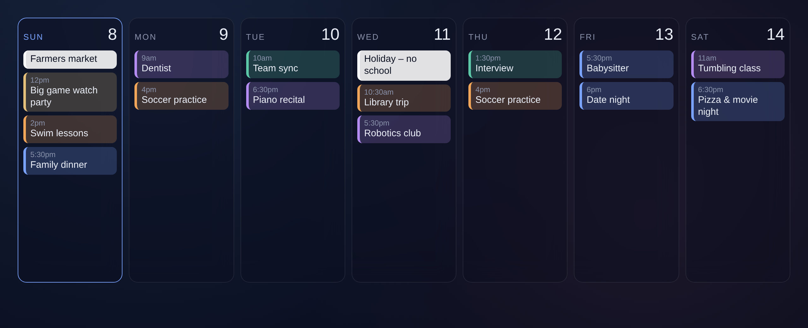

# MMM-WeekBlocks

A week-at-a-glance **block calendar** for [MagicMirror²](https://magicmirror.builders/).
Day columns side by side, with each event shown as a colored block in its calendar's color.



## How it works

MMM-WeekBlocks doesn't fetch calendars itself. It listens for the `CALENDAR_EVENTS` notification that MagicMirror's built-in **calendar** module already broadcasts. You keep the default calendar module for your feeds, hide it, and let MMM-WeekBlocks draw the week.

## Install

```bash
cd ~/MagicMirror/modules
git clone https://github.com/mjescott/MMM-WeekBlocks.git
```

No `npm install` needed.

## Configure

In `config/config.js`:

1. Keep your existing `calendar` module, but **remove its `position`** so it runs in the background.
2. Add MMM-WeekBlocks:

```js
{
  module: "MMM-WeekBlocks",
  position: "middle_center",
  config: {
    days: 7,
    startToday: true,
    maxPerDay: 6
  }
},
```

Make sure the calendar module's `broadcastEvents` is not set to `false` (it's `true` by default). Each feed's `color` setting carries over to its blocks.

## Options

| Option | Default | Description |
|---|---|---|
| `days` | `7` | Number of day columns. |
| `startToday` | `true` | `true` starts at today. `false` starts at the beginning of the week. |
| `maxPerDay` | `6` | Max events per day before showing "+N more". |
| `allDayColor` | `null` | Color used for every all-day event (for example `"#ffffff"`). `null` uses the calendar's color. |
| `rotateBackground` | `false` | Swap the page background on a timer. The next image is preloaded, so there's no flash. |
| `backgroundUrl` | `"https://picsum.photos/1920/1080"` | Image source for background rotation. A cache-busting `random` param is added. |
| `backgroundInterval` | `3600000` | Background swap interval in ms (1 hour). |

## Styling

The module picks up these CSS variables from your theme if you define them in `custom.css`: `--card`, `--card-border`, `--text`, `--text-dim`, `--accent`.

Handy `custom.css` tweaks:

```css
/* Pull the calendar up closer to the clock */
.MMM-WeekBlocks { margin-top: -60px; position: relative; z-index: 5; }

/* Make day columns fill to the bottom of the screen */
.wb-day { height: calc(100vh - 355px); }

/* Hide the module header and outer card */
.MMM-WeekBlocks .module-header { display: none !important; }
.MMM-WeekBlocks {
  background: none !important; border: none !important;
  box-shadow: none !important; backdrop-filter: none !important; padding: 0 !important;
}

/* Solid white all-day events with dark text */
.wb-event.allday {
  --c: #ffffff !important;
  background: rgba(255, 255, 255, 0.88) !important;
  color: #0b1020 !important;
}

/* Custom dimming overlay for background rotation */
:root { --wb-bg-overlay: linear-gradient(180deg, rgba(8,12,28,.75), rgba(8,12,28,.85)); }
```

## License

MIT
